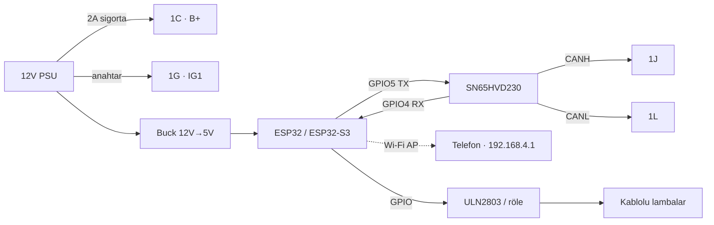

<div align="center">

# 🏁 RX-8 CAN Tezgâhı

### ESP32 ile Mazda RX-8 (SE3P) Gösterge Paneli Simülatörü

2003–2008 Mazda RX-8 gösterge panelini masada **ESP32 / ESP32-S3** ile çalıştırın. Kart motor beyni (PCM) gibi davranır, cluster'ın beklediği CAN mesajlarını **500 kbit/s** hızla yollar; tüm göstergeler ve lambalar telefondan, kartın açtığı Wi-Fi panelinden kontrol edilir.

[](https://erdemerciyas.github.io/Canbus-Ecu/)


</div>

---

## 📑 İçindekiler

- [Özellikler](#-özellikler)
- [Canlı bağlantı föyü](#-canlı-bağlantı-föyü)
- [Hızlı başlangıç](#-hızlı-başlangıç)
- [Proje yapısı](#-proje-yapısı)
- [1. Malzeme](#1-malzeme)
- [2. Cluster soket bağlantıları](#2-cluster-soket-bağlantıları)
- [3. Bağlantı özeti](#3-bağlantı-özeti)
- [4. Yükleme](#4-yükleme)
- [5. Web kontrol paneli](#5-web-kontrol-paneli)
- [6. Gönderilen CAN mesajları](#6-gönderilen-can-mesajları)
- [7. Masada sönmeyebilecek lambalar](#7-masada-sönmeyebilecek-lambalar)
- [8. Sorun giderme](#8-sorun-giderme)
- [9. Sonraki adım: ECU entegrasyonu](#9-sonraki-adım-ecu-entegrasyonu)
- [Kaynaklar](#kaynaklar)

---

## ✨ Özellikler

| | |
|---|---|
| 🚗 **PCM emülasyonu** | Devir, hız, gaz pedalı, hararet, yağ basıncı ve tüm CAN uyarı lambaları |
| 🔑 **Immobilizer cevabı** | `0x047` sorgusuna PCM gibi `0x041` ile cevap verir (araçta lazım olacak) |
| 🟢 **Keep-alive mesajları** | ABS / DSC / EPS lambalarını söndüren "her şey yolunda" çerçeveleri |
| 📱 **Wi-Fi web paneli** | Kurulum gerektirmez; telefondan `http://192.168.4.1` |
| 🎬 **Demo modları** | Hoşgeldin, hoşçakal, ibre süpürme, soğuk çalıştırma, sürüş, gazlama/kesici, ışık şovu |
| 💡 **Kablolu lambalar** | Sinyaller, dörtlü, uzun far, kapı, el freni, fren hidroliği, kemer (GPIO + ULN2803 / röle) |
| ⛽ **Yakıt göstergesi** | Opsiyonel PhotoMOS direnç merdiveni ile ESP32'den kontrol |
| 🔍 **CAN izleme** | Bus üzerindeki bütün ID'leri ve ACK durumunu canlı listeler |
| 🧩 **Çoklu kart** | Klasik ESP32, ESP32-S3 DevKit (YD-ESP32-23) ve Waveshare ESP32-S3-Touch-LCD-2.1; kart otomatik tanınır |
| 📦 **Sıfır bağımlılık** | Harici kütüphane yok; hazır `.bin` dosyalarıyla derlemeden yükleme |

## 🌐 Canlı bağlantı föyü

Etkileşimli atölye föyü — bağlantı şeması, breadboard yerleşimi, gösterge soketi pinout'u, kablo tablosu ve kurulum adımları:

**👉 https://erdemerciyas.github.io/Canbus-Ecu/**

Föy tek dosyadır ([`index.html`](index.html)); tarayıcıda doğrudan açılabilir, açık/koyu temayı destekler ve mobil uyumludur. Tablodaki bir satırın üzerine gelince şemadaki kablosu vurgulanır.

## 🚀 Hızlı başlangıç

```bash
git clone https://github.com/erdemerciyas/Canbus-Ecu.git
cd Canbus-Ecu
```

1. **Bağla:** 12V → `1C` + `1G`, GND → `1E`, CAN-H → `1J`, CAN-L → `1L` ([ayrıntılar](#2-cluster-soket-bağlantıları)).
2. **Yükle:** ESP32-S3 için `yukle_S3.bat`, Waveshare LCD 2.1 için `yukle_LCD21.bat` dosyasına çift tıkla — ya da `pio run -t upload`.
3. **Kontrol et:** **RX8-Cluster** Wi-Fi ağına bağlan (şifre `rx8rotary`) → **http://192.168.4.1**

Açılışta lambalar yanıp ibreler bir tur atıyorsa (Hoşgeldin animasyonu) CAN çalışıyor demektir.

## 📁 Proje yapısı

```
Canbus-Ecu/
├── rx8_cluster/
│   ├── rx8_cluster.ino     # Ana firmware: TWAI sürücüsü, CAN görevleri, web sunucusu
│   ├── config.h            # Kart seçimi, pinler, Wi-Fi, yakıt kalibrasyonu
│   └── web_page.h          # Gömülü web kontrol paneli (HTML/JS)
├── firmware/               # Hazır derlenmiş, 0x0 adresine yazılacak birleşik .bin dosyaları
│   ├── rx8_cluster_ESP32_merged_0x0.bin
│   ├── rx8_cluster_S3_merged_0x0.bin
│   └── rx8_cluster_WS_LCD21_merged_0x0.bin
├── index.html              # Etkileşimli bağlantı föyü (GitHub Pages)
├── platformio.ini          # esp32s3 · ws_lcd21 · esp32dev ortamları
├── yukle_S3.bat            # ESP32-S3 tek tıkla yükleyici
└── yukle_LCD21.bat         # Waveshare ESP32-S3-Touch-LCD-2.1 yükleyici
```

---

## 1. Malzeme

| Parça | Not |
|---|---|
| ESP32 DevKit (WROOM-32) veya ESP32-S3 | Dahili TWAI (CAN) denetleyicisi var |
| SN65HVD230 CAN modülü (VP230) | 3.3V çalışır, doğrudan ESP32'ye bağlanır. Pinler 3.3V · GND · RX · TX; CAN vidalı klemenste, 120 Ω kart üstünde lehimli |
| 12V güç kaynağı (1–2A) + 2A sigorta | Cluster'ı ve ESP32'yi besler |
| 12V→5V buck (MP1584 / LM2596) | ESP32'yi 12V'tan beslemek için |
| ULN2803A | Toprağa çekilen lambalar: kapı, el freni, fren hidroliği, kemer, uzun far |
| 2 kanallı röle modülü veya 2× P-MOSFET high-side | Sinyaller için (+12V ister) |
| 2× 500 Ω potansiyometre | Yakıt göstergesi kalibrasyonu |
| (Opsiyonel) 5× PhotoMOS (AQY212/G3VM-61) + 10/20/39/82/150 Ω dirençler | Yakıtı ESP32'den sürmek için |

> [!TIP]
> TJA1050 modül kullanırsan 5V ile besle, RXD çıkışını 1k/2k bölücüyle 3.3V'a düşür.

## 2. Cluster soket bağlantıları

Kaynak: RX-8 elektrik şeması, Section C-1a…C-1d, konnektör C1-01. Kullanılan tek soket göstergenin arkasındaki küçük 12 pinli soket. Mazda şeması fişi kablo tarafından çizer; göstergedeki sokete arkadan bakınca (kilit tırnağı yukarıda) dizilim şemadakiyle aynıdır: üst sıra soldan sağa 1K 1I 1G 1E 1C 1A, alt sıra 1L 1J 1H 1F 1D 1B. Güç vermeden önce 1J–1L arasında ~120 Ω ölçerek doğrula.

### Minimum (göstergelerin çalışması için yeterli)

| Pin | Renk | Görev | Bağlantı |
|---|---|---|---|
| **1C** | L/R | Sürekli +B (ROOM sigortası) | +12V |
| **1G** | B/Y | Kontak IG1 | +12V (anahtar ya da röle üzerinden) |
| **1E** | B | Şase | GND |
| **1J** | L/W | CAN H | SN65HVD230 **CANH** |
| **1L** | G/B | CAN L | SN65HVD230 **CANL** |

- Cluster'ın içinde 1J–1L arasında sonlandırma direnci var. Enerji yokken ölç: yaklaşık 120 Ω görmelisin. Modüldeki 120 Ω ile birlikte toplam ~60 Ω olur; bu doğru.
- Cluster ACK vermezse (web panelinde "ACK yok") önce CANH/CANL'yi ters bağla. Ters bağlamak zarar vermez.
- Modülde RX/TX yazar ve bağlantı UART gibi çapraz değildir: ESP32 TX → modül TX, modül RX → ESP32 RX. Doğrulamak için süreklilik modunda ölç: TX pini çipin 1. bacağına (D), RX pini 4. bacağına (R) gitmeli. Ters çıkarsa iki sinyal kablosunu yer değiştir.

> [!IMPORTANT]
> **ESP32 GND, transceiver GND ve cluster 1E aynı toprakta olmalı.**

### Kablolu lambalar

| Pin | Lamba | Nasıl sürülür | ESP32 pini |
|---|---|---|---|
| 2G | Sol sinyal | +12V verilince yanar | GPIO32 → röle |
| 2I | Sağ sinyal | +12V verilince yanar | GPIO33 → röle |
| 2B + 2D | Uzun far | 2B sürekli +12V, 2D toprağa çekilince yanar | GPIO25 → ULN2803 → 2D |
| 2E | Kapı açık | Toprağa çekilince | GPIO13 → ULN2803 |
| 2M | El freni (BRAKE) | Toprağa çekilince | GPIO14 → ULN2803 |
| 1D | Fren hidroliği (BRAKE) | Toprağa çekilince | GPIO27 → ULN2803 |
| 2A | Emniyet kemeri (SAS'tan) | Deneysel, toprağa çekme | GPIO26 → ULN2803 |
| 2U | Panel aydınlatma dimmer | Boş bırakılabilir | – |

ULN2803: GND → ortak toprak, COM (pin 10) → +12V, girişler doğrudan ESP32 GPIO'larına.

### Yakıt göstergesi (CAN ile sürülmez)

Yakıt göstergesi iki rezistif şamandıradan okunur:

- **Ana şamandıra:** 2R (R/L) ↔ 2T (B/O)
- **Yan şamandıra:** 2P (W/G) ↔ 2T (B/O), 2T ortak dönüş hattı

Bağlı değilse ibre E'de kalır, düşük yakıt lambası yanar.

<details>
<summary><b>Kalibrasyon adımları</b></summary>

1. 2R–2T ve 2P–2T arasına birer 500 Ω pot tak.
2. Kontağı aç. İbrenin F ve E'ye gittiği konumları bul. Cluster yakıtı yavaş filtreler; her ayardan sonra 30–60 sn bekle.
3. Potları sökmeden, enerji kesikken multimetreyle ölç. Değerleri `config.h` içindeki `FUEL_OHM_FULL` / `FUEL_OHM_EMPTY` alanlarına yaz.
4. Yan şamandırayı istediğin seviyede sabit bir dirençle bırakabilirsin.
5. Yakıtı ESP32'den kontrol etmek için ana hatta 5 seri direnç kullan. Her direnci bir PhotoMOS kısa devre etsin. PhotoMOS LED'lerini GPIO16/17/18/19/21'den 390 Ω üzerinden sür. Sonra `FUEL_LADDER_ENABLED 1` yap.

</details>

### ESP32-S3 pinleri

Kod kartı otomatik tanır. ESP32-S3'te aşağıdaki pinler kullanılır. Klasik ESP32 pinleri yukarıdaki tablolarda.

Kullanılan kart: **YD-ESP32-23** (VCC-GND Studio, ESP32-S3 N16R8, DevKitC-1 klonu, [pinout](https://github.com/rtek1000/YD-ESP32-23)). Tablodaki bütün pinler kartın J1 sırasında. Durum LED'i (WS2812, GPIO48) için kart üstündeki **RGB** lehim köprüsü kapatılmalı; fabrikadan açık gelir. Kartın 5V pinine bir şey bağlama.

| Görev | S3 GPIO |
|---|---|
| CAN TX → SN65 TX (CTX) | 5 |
| CAN RX ← SN65 RX (CRX) | 4 |
| Kapı (2E) / El freni (2M) / Fren hidroliği (1D) | 6 / 7 / 15 |
| Kemer (2A) / Uzun far (2D) | 16 / 17 |
| Sol sinyal (2G) / Sağ sinyal (2I) | 18 / 8 |
| Yakıt merdiveni bit0..4 | 9, 10, 11, 12, 13 |

> [!WARNING]
> GPIO 19/20 (USB), 26–37 (flash/PSRAM) ve 0/3/45/46 (strapping) pinlerini kullanma.

**Yükleme:** ESP32-S3'ü USB ile bağla ve `yukle_S3.bat` dosyasına çift tıkla. Port otomatik bulunur.

### Waveshare ESP32-S3-Touch-LCD-2.1

Bu kartta ekran, dokunmatik ve SD kart neredeyse bütün GPIO'ları kullanır; dışarı sadece 12 pinli SH1.0 soketi açılır. Ekran kullanılmaz, arka ışığı kapalı tutulur. Kontrol telefondan web paneliyle yapılır.

| Görev | GPIO | 12PIN soket |
|---|---|---|
| CAN TX → SN65 TX (CTX) | 20 (D+) | pin 4 |
| CAN RX ← SN65 RX (CRX) | 19 (D−) | pin 3 |
| SN65 3V3 / GND | – | pin 6 / pin 5 |

- Kablolu lambalar ve yakıt merdiveni bu kartta yok (boş pin kalmıyor). Web panelinde o düğmeler gizlenir.
- Kartı **UART** yazan Type-C portundan bağla, diğer USB-C portunu boş bırak. Serial log da bu porttan gelir.
- **Yükleme:** `yukle_LCD21.bat` dosyasına çift tıkla. PlatformIO varsa `ws_lcd21` ortamını derleyip yükler, yoksa `firmware/rx8_cluster_WS_LCD21_merged_0x0.bin` dosyasını yazar.
- Arduino IDE ile: `config.h`'de `BOARD_WS_TOUCH_LCD_21` satırını aç, kart **ESP32S3 Dev Module**, **USB CDC On Boot: Disabled**.

## 3. Bağlantı özeti

```
12V PSU (+) ──[2A sigorta]──┬── 1C (B+)
                            ├── [anahtar] ── 1G (IG1)
                            ├── 2B (uzun far +)
                            ├── röle COM'ları ──► 2G / 2I (sinyaller)
                            └── buck 5V ── ESP32 VIN
12V PSU (−) ────────────────┴── 1E, ESP32 GND, SN65 GND, ULN2803 GND

ESP32 GPIO5 ── SN65HVD230 TX  (CTX)        SN65 CANH ── 1J
ESP32 GPIO4 ── SN65HVD230 RX  (CRX)        SN65 CANL ── 1L
ESP32 3V3   ── SN65HVD230 3.3V
```



## 4. Yükleme

### Arduino IDE

1. Arduino IDE → Board Manager → **esp32 by Espressif** (2.x veya 3.x).
2. `rx8_cluster` klasörünü aç. Üç dosya aynı klasörde olmalı: `rx8_cluster.ino`, `config.h`, `web_page.h`.
3. Kart olarak **ESP32 Dev Module** (S3 için **ESP32S3 Dev Module**) seç ve yükle. Harici kütüphane gerekmez.
4. Telefonu/PC'yi **RX8-Cluster** ağına bağla (şifre `rx8rotary`). Tarayıcıda **http://192.168.4.1** adresini aç.
5. Seri monitörü 115200 baud'da aç; durum her 5 saniyede bir yazılır.

### VS Code + PlatformIO

Proje kökündeki `platformio.ini` hazır. Klasörü VS Code'da aç, alt bardan ortamı seç, **Upload** (→), ardından **Monitor** de.

| Ortam | Kart |
|---|---|
| `esp32s3` *(varsayılan)* | ESP32-S3 DevKitC-1 / YD-ESP32-23 (16MB) |
| `ws_lcd21` | Waveshare ESP32-S3-Touch-LCD-2.1 |
| `esp32dev` | Klasik ESP32 (WROOM-32) |

```bash
pio run -e esp32s3 -t upload && pio device monitor -b 115200
```

### Hazır firmware ile yükleme (derlemeden)

`firmware/` klasöründeki dosyalar Arduino-ESP32 2.0.17 ile derlendi; her biri bootloader, bölüm tablosu ve uygulamayı tek parçada içerir.

| Dosya | Kart |
|---|---|
| `rx8_cluster_ESP32_merged_0x0.bin` | Klasik ESP32 |
| `rx8_cluster_S3_merged_0x0.bin` | ESP32-S3 DevKit |
| `rx8_cluster_WS_LCD21_merged_0x0.bin` | Waveshare ESP32-S3-Touch-LCD-2.1 |

1. Chrome ile https://espressif.github.io/esptool-js/ adresini aç.
2. Baud hızını 921600 seç, **Connect** de ve ESP32'nin COM portunu seç.
3. Flash Address olarak **0x0** yaz, kartına uygun `.bin` dosyasını seç ve **Program** de.

Komut satırından:

```bash
python -m esptool --chip esp32s3 --baud 921600 write_flash 0x0 firmware/rx8_cluster_S3_merged_0x0.bin
```

## 5. Web kontrol paneli

ESP32 **RX8-Cluster** adında bir erişim noktası açar (şifre `rx8rotary`, `config.h` içinden değiştirilebilir). Panel **http://192.168.4.1** adresindedir:

- **Göstergeler:** devir, hız, hararet, yağ basıncı, yakıt, gaz pedalı kaydırıcıları
- **Modlar:** Hoşgeldin · Hoşçakal · İbre süpürme · Soğuk çalıştırma · Sürüş ↻ · Gazlama / kesici ↻ · Işık şovu ↻
- **CAN uyarı lambaları:** Check Engine (sabit / yanıp sönen), şarj, yağ basıncı, düşük antifriz, ABS, fren (EBD), DSC OFF, TCS
- **Kablolu lambalar:** sol / sağ sinyal, dörtlü, uzun far, kapı, el freni, fren hidroliği, emniyet kemeri, tüm lambalar aç/kapat
- **CAN durumu:** ACK durumu ve cluster'ın (ileride ECU'nun) yolladığı bütün ID'ler

## 6. Gönderilen CAN mesajları

| ID | Periyot | İçerik |
|---|---|---|
| `0x201` | 20 ms | B0-1: rpm × 3.85 (bazı panellerde ×4), B2-3: FF FF, B4-5: km/s × 100 + 10000, B6: gaz % × 2, B7: FF |
| `0x420` | 100 ms | B0: hararet (ham, ~145 = orta), B1: odometre sayacı, B4: yağ basıncı (0/1+), B5 bit6: Check Engine, bit7: CE yanıp sönme, B6 bit1: düşük antifriz, bit6: şarj, bit7: yağ |
| `0x212` | 100 ms | B3 bit2: DSC OFF, B4 bit3: ABS, bit6: fren, B5 bit5: TCS yanıp sönme, bit4: TCS kapalı |
| `0x203` `0x215` `0x231` `0x240` `0x620` `0x630` `0x650` | 100 ms | PCM keep-alive mesajları: ABS/DSC lambalarının sönmesi ve AT/MT seçimi için |
| `0x300` | 100 ms | EPS (direksiyon) uyarısını söndürür |
| `0x041` | olaya bağlı | `0x047` immobilizer sorgusuna PCM cevabı (araçta lazım olacak) |

## 7. Masada sönmeyebilecek lambalar

Masada aşağıdaki lambalar yanık kalabilir. Bu normaldir ve ESP32'den kaynaklanmaz:

- **Airbag:** SAS modülünden kablo ile gelir (2K).
- **TPMS:** Lastik basınç modülü olan araçlarda.
- **Güvenlik / anahtar lambası:** Keyless modülünden gelir (2F).

ABS/DSC lambası sönmezse panelden **0x620 byte6** değerini 2, 3 ve 4 olarak dene.

## 8. Sorun giderme

| Belirti | Olası neden / çözüm |
|---|---|
| Panelde "ACK yok" | CANH/CANL'yi ters bağla; 1J–1L arası ~120 Ω olmalı; ortak toprağı kontrol et |
| Hiç CAN trafiği yok | TX/RX çapraz bağlanmış olabilir — ESP32 TX → modül TX olmalı |
| İbreler hareket etmiyor | 1G (IG1) beslemesini kontrol et |
| Devir yanlış gösteriliyor | Bazı panellerde çarpan ×3.85 yerine ×4 |
| ABS/DSC yanık kalıyor | `0x620` byte6 değerini 2, 3, 4 dene |
| Yükleme başlamıyor | BOOT'u basılı tut, RESET'e bas-bırak, BOOT'u bırak ve tekrar dene |
| Wi-Fi ağı görünmüyor | Seri monitörü 115200 baud'da açıp açılış logunu kontrol et |

## 9. Sonraki adım: ECU entegrasyonu

Bütün gösterge değerleri `ClusterState S` yapısında. ECU'dan gelen veriyi bu alanlara yazman yeterli. Örnek: ikinci bir CAN veya UART'tan okunan rpm'i `S.rpm`'e yaz; gönderim görevi bunu otomatik yayınlar. Gerçek araçta orijinal PCM sökülürse immobilizer cevabı ve keep-alive mesajları zaten hazır.

---

## Kaynaklar

- DaveBlackH, *MazdaRX8Arduino*: https://github.com/DaveBlackH/MazdaRX8Arduino
- xsimulator.net RX-8 cluster başlığı: https://www.xsimulator.net/community/posts/43151
- RX-8 Elektrik Şeması, Section C-1a…C-1d, B-2
- YD-ESP32-23 pinout: https://github.com/rtek1000/YD-ESP32-23

> [!CAUTION]
> Bu proje masa üstü test ve eğitim amaçlıdır. Gerçek araçta kullanmadan önce bağlantıları doğrulayın; araç CAN hattına yapılan müdahaleler güvenlik sistemlerini etkileyebilir.

<div align="center">

**Anahtar kelimeler:** Mazda RX-8 · gösterge paneli · instrument cluster · CAN bus · ESP32 · ESP32-S3 · TWAI · SN65HVD230 · PCM simülatörü · Arduino · PlatformIO

</div>
